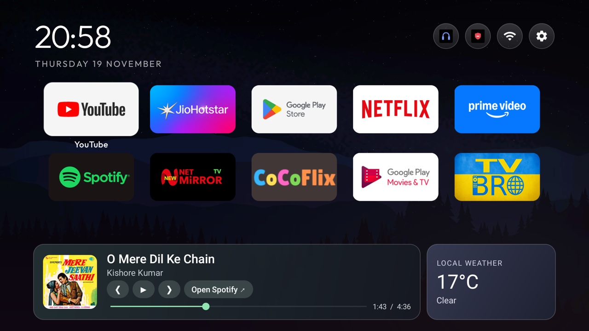
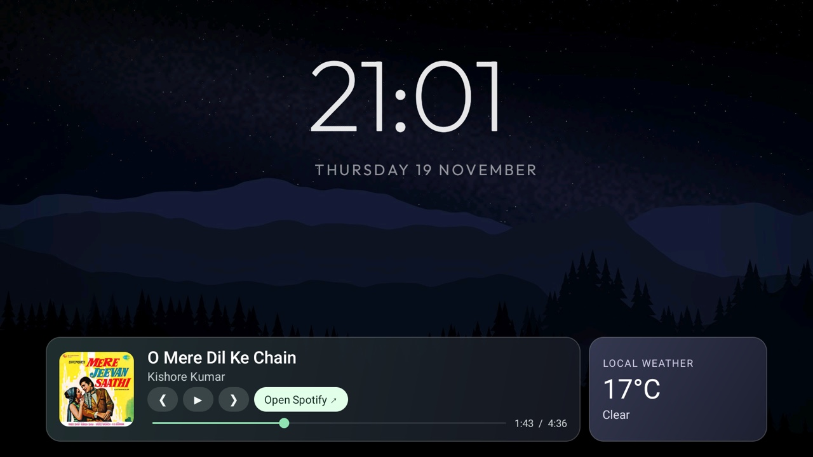

# Spotify controls and weather for CleanYourTV
This experimental fork adds an optional shelf below the app grid and on the launcher’s idle clock. Spotify handles sign-in, audio and playback. The shelf displays the track and artist, artwork supplied by Spotify (including opt-in album covers), elapsed time and duration. Transport controls follow the actions Spotify advertises. Open Spotify also works when there is no active session.

## Build and configure
From the root, run `bash tools/docker-build.sh launcher -PlauncherApplicationId=dev.tvwidgets.home :app:assembleRelease :companion:assembleRelease`. Build and sign both applications together. Install the two release APKs locally, installing the companion first. Open the fork for a preview with `am start -n dev.tvwidgets.home/com.gathin.tvhome.MainActivity`.

Set `"widget_shelf": true` in the fork’s theme config.json to enable both surfaces. The feature is off by default. The prototype layout is designed for a five-column, two-row Home screen. On the clock, press Down to focus the controls and Back to return to Home.

To enable weather, place weather.json in the companion’s external files directory. It accepts city (a display name), latitude and longitude (decimal degrees), e.g. `{"city":"London","latitude":51.5,"longitude":-0.12}`. Without this file the companion does not request a forecast. Weather shows temperature in Celsius and current conditions, with a cached reading on network failures.

## Permissions and data
- Android notification access is an explicit grant to the companion’s NotificationListenerService. Android grants broad access. The implementation does not handle, log or store notification contents. It reads the active media sessions, selects the one belonging to com.spotify.tv.android and passes its token to the signed host. Revoke access in Android Settings to stop discovery.
- INTERNET belongs to the companion. For weather it sends the configured coordinates to Open-Meteo via HTTPS and caches the formatted forecast locally. Optional album artwork uses only HTTPS image URLs from i.scdn.co supplied by the Spotify media session. To enable it, create an empty spotify-artwork.enabled file beside weather.json. Spotify’s CDN receives the image identifier and device IP. The companion keeps the decoded cover in memory and makes no track-title or artist searches. Weather attribution: Open-Meteo (https://open-meteo.com/).
- The launcher requests the signature-protected dev.tvwidgets.permission.SESSION to bind the companion. The launcher has no INTERNET permission. No Spotify API key, user credentials, overlay or accessibility grant is required for the widgets.
- Spotify playback controls affect the current Spotify session and can be unavailable for some accounts, devices or tracks. Back on the idle clock exits the controls.

## Mi Box test and rollback
Tested on Xiaomi MIBOX4, Android TV 9 (SDK 28), PI.3933. The widget shelf fits below the two existing five-app rows on the Ridgelines theme. Home and the launcher idle clock were tested with a real Spotify session. The test used an accelerated one-minute idle interval, with a ten-minute interval for normal use. The clock in this fork is the Home idle clock; the separate Android system Backdrop dream is a different surface.

On this test box, the prior clean launcher remains installed. To return to it, run `cmd package set-home-activity com.gathin.tvhome.clean/com.gathin.tvhome.MainActivity` in the authorized TV shell and press Home. To revoke the companion’s test grant, use Android’s Notification access settings or `cmd notification disallow_listener dev.tvwidgets.companion/.Access`.

The showcase candidate is a fork with a companion. An upstream listing would go under Forks → Added features after this source is published in its own repository. Keep the device weather config and unredacted TV screenshots private.

## Screenshots from the Mi Box

